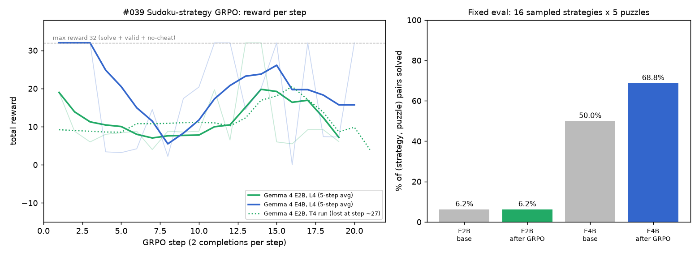

# #039 Teaching Gemma 4 to write Sudoku strategies with GRPO (E2B vs E4B)

**Result:** 20 steps of GRPO were enough to move the bigger model and not enough for the smaller one. **Gemma 4 E4B** went from solving 50.0% to **68.75%** of (strategy, puzzle) pairs, and from 27.8 to **38.0/40** valid moves. **Gemma 4 E2B** started and ended at **6.25%**. Its valid moves rose from 24.6 to 29.4/40, but valid-function rate fell from 100% to 93.75%, and its replies got longer (669 → 985 tokens).

| | E2B base | E2B after GRPO | E4B base | E4B after GRPO |
|---|---|---|---|---|
| Solve rate (16 strategies × 5 puzzles) | 6.25% | 6.25% | 50.0% | **68.75%** |
| Strategies solving all 5 puzzles | 6.25% | 0% | 50.0% | 68.75% |
| Mean valid moves (of 40) | 24.6 | 29.4 | 27.8 | **38.0** |
| Valid Python function | 100% | 93.75% | 100% | 100% |
| Mean completion tokens | 669 | 985 | 884 | 922 |
| GRPO steps done (time cap) | | 19 (33 min cap) | | 20 (50 min cap) |
| Seconds per step on L4 | | 110 | | 154 |

**Setup.** Unsloth's Gemma 4 Sudoku GRPO notebook (`scripts/orig.ipynb`), adapted by `scripts/build_notebook.py`. Models: `unsloth/gemma-4-E2B-it` and `unsloth/gemma-4-E4B-it`, 16-bit LoRA r=32, 2 completions per prompt, lr 5e-5, beta 0.001, max completion length 1024, 20 GRPO steps with a wall-clock stop. The model writes a Python strategy function. Rewards: the function works, it doesn't cheat, and the strategy succeeds (max total 32). The fixed eval samples 16 strategies on 5 puzzles. It is the same eval before and after training.

**GPU.** The first E2B run used a **T4** (session tig039, 100-step plan). It was **terminated server-side** at 21:13:41 UTC after about 100 min, at about step 27, before results were downloaded. Its base eval and reward curve up to step 27 were recovered from progress polls (`results/t4_e2b_run_partial.json`, dotted line on the chart). Everything else ran on an **L4**.

**Compute (L4 at 1.54 CU/h).**
| Session | GPU | What | Minutes | CU |
|---|---|---|---|---|
| tig039 | T4 | E2B, lost | 100 | ~1.78 |
| tig039b | L4 | E4B | 68.7 | ~1.76 |
| tig039c | L4 | E2B | 49.6 | ~1.27 |
| **Total** | | | | **~4.81** |

Files: `scripts/analyse.py` → `chart.png`, `results/summary_table.json` · `results/e4b_l4/results/`, `results/e2b_l4/results/` (eval_base/eval_trained JSON with every sampled strategy, train_log.jsonl, progress.log) · `scripts/sudoku_grpo_039_e{2,4}b_l4.ipynb`, `scripts/launch_*.py`.
